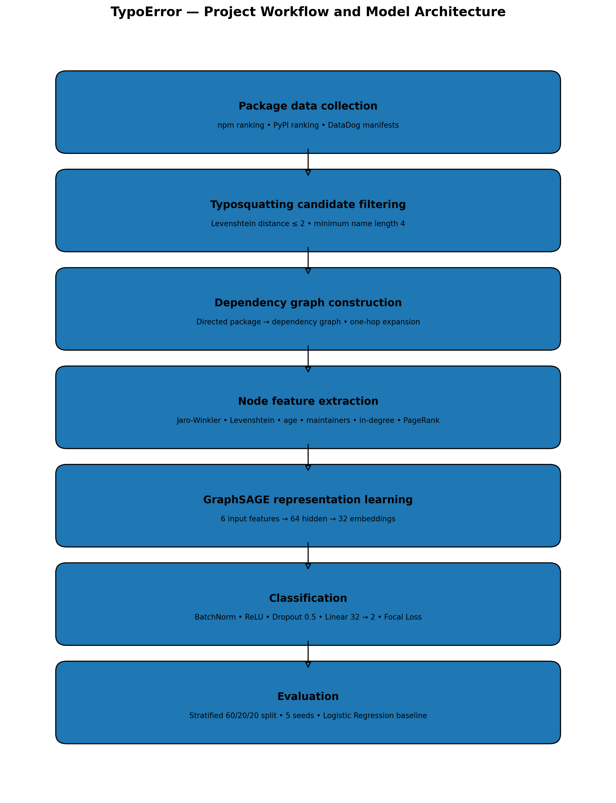
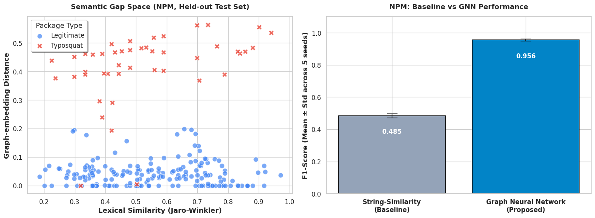
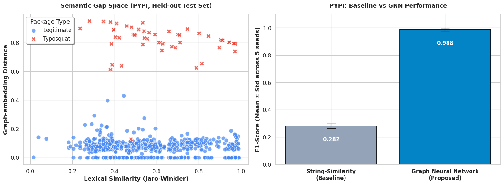

# TypoError: Graph-Based Typosquatting Detection in Software Supply Chains

An experimental Graph Neural Network (GNN) approach for identifying typosquatting packages in the **npm** and **PyPI** ecosystems using package-name similarity, package metadata, and dependency relationships.

## Overview

Typosquatting occurs when a malicious package uses a name that closely resembles a popular, legitimate package. This project builds package dependency graphs and applies a GraphSAGE-based model to classify package nodes as legitimate or typosquatting candidates.

The notebook retrieves package information from public registry APIs and public package datasets at runtime.

## Methodology

1. **Data collection:** Popular package lists for npm and PyPI are combined with malicious-package manifests from the DataDog malicious software packages dataset.
2. **Candidate filtering:** Malicious-manifest package names are compared with popular package names using Levenshtein distance. The notebook uses a maximum edit distance of 2 and a minimum package-name length of 4.
3. **Dependency graph construction:** A directed graph is created with edges from a package to its dependencies. The recorded experiment uses one-hop dependency expansion.
4. **Feature extraction:** Six node features are calculated:
   - Maximum Jaro-Winkler similarity to the popular-package reference pool
   - Minimum Levenshtein distance to that pool
   - Package age in days
   - Maintainer count or PyPI maintainer-presence proxy
   - In-degree
   - PageRank score
5. **Model training:** A two-layer GraphSAGE model learns 32-dimensional node embeddings. A linear classifier predicts two classes. Focal Loss is used during training.
6. **Baseline comparison:** A class-weighted Logistic Regression model is trained using only the two lexical features.
7. **Robustness evaluation:** Results are collected across five random seeds using stratified train, validation, and test splits.

## Model Architecture

The model uses 6 input features, a 64-channel GraphSAGE hidden layer, Batch Normalization, ReLU, Dropout (0.5), a 32-dimensional GraphSAGE output, and a final linear classifier.

## Experimental Results

The following are the saved results from the notebook execution included with this project. Values are mean ± standard deviation across five seeds.

### Graph Statistics

| Ecosystem | Nodes | Edges | Feature Count |
|---|---:|---:|---:|
| npm | 1,145 | 1,400 | 6 |
| PyPI | 3,105 | 7,847 | 6 |

### F1-Score Comparison

| Ecosystem | GraphSAGE GNN | Logistic Regression Baseline |
|---|---:|---:|
| npm | 0.9562 ± 0.0074 | 0.4852 ± 0.0126 |
| PyPI | 0.9877 ± 0.0116 | 0.2817 ± 0.0160 |

### Additional Metrics

| Ecosystem | Model | Precision | Recall | PR-AUC | ROC-AUC |
|---|---|---:|---:|---:|---:|
| npm | GraphSAGE GNN | 0.9654 ± 0.0243 | 0.9478 ± 0.0194 | 0.9762 ± 0.0182 | 0.9841 ± 0.0145 |
| npm | Logistic Regression | 0.3348 ± 0.0115 | 0.8826 ± 0.0395 | 0.5385 ± 0.0608 | 0.8383 ± 0.0271 |
| PyPI | GraphSAGE GNN | 0.9900 ± 0.0224 | 0.9860 ± 0.0192 | 0.9984 ± 0.0027 | 0.9998 ± 0.0003 |
| PyPI | Logistic Regression | 0.1712 ± 0.0110 | 0.7965 ± 0.0423 | 0.2464 ± 0.0430 | 0.7504 ± 0.0281 |

### Evaluation Visualizations

**npm**

**PyPI**

The per-seed metric tables are available in the `results/` directory.

## Data Sources

- [npm package ranking dataset](https://github.com/tristan-f-r/npm-rank)
- [Top PyPI packages dataset](https://github.com/hugovk/top-pypi-packages)
- [DataDog malicious software packages dataset](https://github.com/DataDog/malicious-software-packages-dataset)
- [npm Registry API](https://registry.npmjs.org/)
- [PyPI JSON API](https://pypi.org/pypi/)

The notebook downloads these sources dynamically. Their contents may change over time.

## Reproducibility

The notebook was developed and executed in a Kaggle Notebook environment with Python 3.12.13. It automatically selects CUDA when available and otherwise uses CPU.

1. Open `typoerror_typosquatting_detection.ipynb` in Kaggle or a compatible Jupyter environment.
2. Ensure Internet access is enabled because package lists, manifests, and registry metadata are fetched at runtime.
3. Install the dependencies listed in `requirements.txt`. Install a PyTorch build compatible with your CPU/CUDA environment before running PyTorch Geometric if needed.
4. Run the notebook cells in order.

The original notebook writes generated outputs to `/kaggle/working/`. When running outside Kaggle, change those output paths to a local output directory.

## Limitations

- **Heuristic labels:** Positive examples are drawn from the DataDog manifests only when they also pass the notebook's edit-distance filter. Other graph nodes are treated as legitimate, although some may be unlabelled or malicious.
- **Lexical label-feature overlap:** Edit distance is used in candidate filtering and lexical similarity is also included among the model features. This can make the evaluation optimistic and should be considered when interpreting the scores.
- **Transductive evaluation:** The graph and node features are constructed before the node-level train/validation/test split. The model therefore uses the full graph structure during message passing; this does not measure performance on completely unseen package graphs.
- **Feature-scaling leakage:** Min-max scaling is performed on the full feature matrix before splitting, so test-set distribution information is included in preprocessing.
- **PyPI maintainer proxy:** The PyPI API does not provide the same maintainer-count field used for npm in this notebook. PyPI maintainer information is approximated as 1 when an author or maintainer email is present, otherwise 0.
- **Changing external data:** Registry metadata and package-ranking datasets can change, so reruns may not reproduce exactly the same graph or scores.
- **Limited graph scope:** The experiment uses sampled seed packages and one-hop dependency expansion.

These results describe the notebook's experimental setup and should not be interpreted as production-grade detection performance or as a guarantee that a package is safe.

## Conclusion

In the recorded experiments, GraphSAGE achieved higher F1-scores than the lexical-only Logistic Regression baseline on both npm and PyPI. The results suggest that dependency-graph information may add useful signals beyond package-name similarity. Further validation with independently verified labels, leakage-resistant preprocessing, temporal splits, and unseen-package evaluation is required before drawing broader conclusions.
